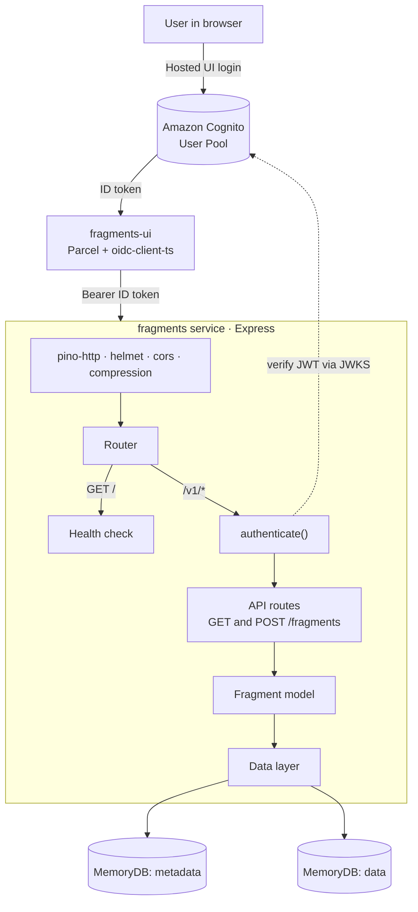
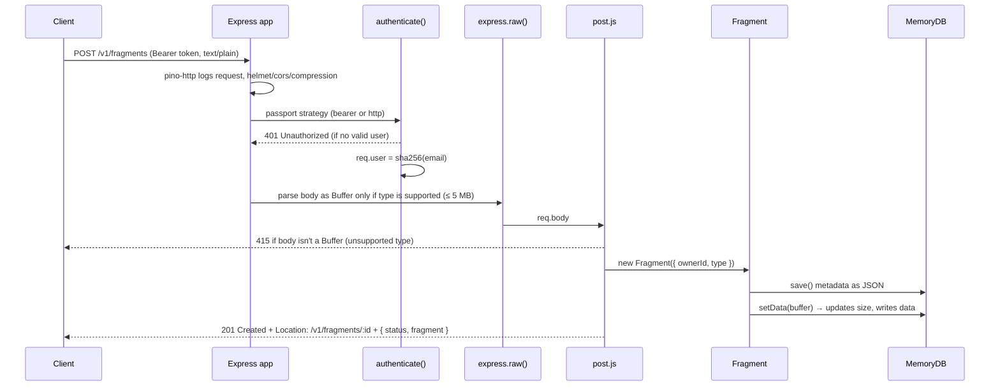

# Fragments: a cloud-native microservice case study

> **Course:** CCP555 — Cloud Computing for Programmers, Seneca Polytechnic (Fall 2026) <br/>
> **Author:** Natasha Ejercito <br/>
> **Source:** `fragments` (back-end API) and `fragments-ui` (test web client) — private course repos; code available on request <br/>
> **Status:** Assignment 1 complete — living document, updated each assignment <br/>
> **Last updated:** November 1, 2026

---

## Table of contents

1. [Overview](#1-overview)
2. [Goals](#2-goals)
3. [Architecture](#3-architecture)
4. [Request lifecycle](#4-request-lifecycle)
5. [Authentication](#5-authentication)
6. [Data model and storage](#6-data-model-and-storage)
7. [API surface](#7-api-surface)
8. [Testing and CI](#8-testing-and-ci)
9. [Containerization and deployment](#9-containerization-and-deployment)
10. [The client: fragments-ui](#10-the-client-fragments-ui)
11. [Key decisions and trade-offs](#11-key-decisions-and-trade-offs)
12. [Challenges and lessons learned](#12-challenges-and-lessons-learned)
13. [Known gaps and next steps](#13-known-gaps-and-next-steps)
14. [Changelog by assignment](#14-changelog-by-assignment)

---

## 1. Overview

**Fragments** is a small HTTP microservice that lets an authenticated user store and retrieve
"fragments" — pieces of content such as text — tied to their account. It is built with
Node.js and Express 5, authenticates users through Amazon Cognito, and is packaged as a Docker
image for deployment on AWS.

The point of the project isn't the feature set (storing text is simple). It's practising the
things that make a service production-ready: authentication, structured logging, test
coverage, continuous integration, containerization and cloud deployment, all built
incrementally across the term.

|                         |                                                                       |
| ----------------------- | --------------------------------------------------------------------- |
| **Runtime**             | Node.js 24, Express 5 (CommonJS)                                      |
| **Auth**                | Amazon Cognito (JWT bearer) in production · HTTP Basic Auth for tests |
| **Logging**             | Pino + pino-http (JSON), pino-pretty in debug                         |
| **Security middleware** | helmet, cors, compression                                             |
| **Storage**             | In-memory (stand-in for DynamoDB + S3)                                |
| **Testing**             | Jest 30 + Supertest — 11 suites, 62 tests, ~98.6% line coverage       |
| **Quality**             | ESLint 10 (flat config), Prettier                                     |
| **CI**                  | GitHub Actions — lint + unit tests on every push/PR to `main`         |
| **Packaging**           | Docker (`node:24.13.0` base)                                          |

## 2. Goals

- **Secure by default.** Every `/v1/*` route requires authentication. The only public endpoint
  is the health check.
- **Privacy-aware.** The service never stores a user's email. It keys all data by a SHA-256
  hash of the email.
- **Swappable infrastructure.** Auth strategy and storage backend sit behind interfaces, so
  the code that handles requests doesn't change when the infrastructure underneath does.
- **Test-first confidence.** Enforce at least 80% line coverage in Jest and run it in CI so
  `main` stays green.
- **Observable.** Structured JSON logs at every meaningful step, with crash events logged
  before the process exits.

## 3. Architecture



The code follows a layered structure. Each layer only talks to the one directly below it:

```
src/
├── index.js            # entry: loads .env, logs uncaught errors, starts server
├── server.js           # app.listen() wrapped in stoppable for graceful shutdown
├── app.js              # middleware stack, 404 + error handlers
├── logger.js           # Pino instance (pretty when level=debug)
├── response.js         # createSuccessResponse / createErrorResponse
├── hash.js             # sha256(email) → owner id
├── auth/
│   ├── index.js        # picks Cognito OR Basic Auth from env (never both)
│   ├── cognito.js      # Bearer strategy + aws-jwt-verify
│   ├── basic-auth.js   # http-auth + .htpasswd (tests/dev only)
│   └── auth-middleware.js  # shared callback: 401 handling + email hashing
├── routes/
│   ├── index.js        # GET / (health) and mounts /v1 behind authenticate()
│   └── api/            # index.js (router + raw body parser), get.js, post.js
└── model/
    ├── fragment.js     # Fragment class: validation, save/getData/setData
    └── data/
        ├── index.js    # chooses storage strategy (memory for now)
        └── memory/     # MemoryDB + metadata/data stores
```

Separating `app.js` (builds the Express app) from `server.js` (calls `listen()`) means
Supertest can import the app and exercise every route without opening a real port.

## 4. Request lifecycle

What happens on `POST /v1/fragments` with a text body:



Two details worth calling out:

- **The body parser is type-aware.** `express.raw()` receives a custom `type` function that
  calls `Fragment.isSupportedType()`. Unsupported content types are never parsed, so
  `req.body` isn't a Buffer and the route returns **415** cleanly instead of trying to
  handle data it doesn't understand.
- **`Location` respects `API_URL`.** Behind a load balancer or proxy, `req.headers.host`
  can be wrong, so the URL base comes from `API_URL` when it's set.

## 5. Authentication

Auth is selected at startup from environment variables in `src/auth/index.js`:

| Env present                                       | Strategy              | Used for                |
| ------------------------------------------------- | --------------------- | ----------------------- |
| `AWS_COGNITO_POOL_ID` + `AWS_COGNITO_CLIENT_ID`   | Cognito JWT (Bearer)  | Production / real users |
| `HTPASSWD_FILE` (and `NODE_ENV !== 'production'`) | HTTP Basic Auth       | Unit tests, local dev   |
| Both                                              | **Throws at startup** | Misconfiguration guard  |
| Neither                                           | **Throws at startup** | Misconfiguration guard  |

**Cognito path.** `aws-jwt-verify` checks the token's signature, issuer, audience
(`clientId`) and `token_use: id`. On startup the verifier calls `hydrate()` to download and
cache the user pool's public keys (JWKS), so the first real request doesn't pay that latency.

**Shared middleware.** Both strategies run through one custom callback
(`auth-middleware.js`). It does three things:

- turns a missing user into a consistent `401` JSON error
- turns strategy errors into a `500`
- replaces the email with `sha256(email)` before any route sees it

Because of that, route handlers and the data layer only ever see an opaque owner id.

> **Why fail fast on config?** A service that silently starts with _no_ auth, or with test
> credentials in production, is worse than one that refuses to start. Throwing at boot
> surfaces the problem immediately in logs and CI.

## 6. Data model and storage

A `Fragment` holds **metadata** (`id`, `ownerId`, `created`, `updated`, `type`, `size`). The
**data** (raw bytes) is stored separately. That split mirrors the AWS design the course is
heading toward:

| Store      | Today                                         | Planned AWS equivalent |
| ---------- | --------------------------------------------- | ---------------------- |
| `metadata` | `MemoryDB`, values serialized as JSON strings | DynamoDB               |
| `data`     | `MemoryDB`, values stored as Buffers          | S3                     |

The model validates on construction:

- `ownerId` and `type` are required
- `size` must be a non-negative number
- `type` must be supported

IDs come from `crypto.randomUUID()`. Supported types currently live in a single allow-list
(`['text/plain']`). Content-type parameters such as `; charset=utf-8` are accepted because
`isSupportedType()` parses the header before comparing.

Metadata is deliberately stored as a **JSON string**, not a live object. That simulates
network serialization now, so bugs that would only appear once the data lives in DynamoDB
(for example, forgetting to rehydrate a plain object into a `Fragment`) show up locally first.

## 7. API surface

| Method | Path            | Auth     | Response                                                                                                  |
| ------ | --------------- | -------- | --------------------------------------------------------------------------------------------------------- |
| `GET`  | `/`             | none     | `200` health JSON: description, author, GitHub URL, version, timestamp (`Cache-Control: no-cache`)        |
| `GET`  | `/v1/fragments` | required | `200 { status: "ok", fragments: [] }` _(placeholder — see §13)_                                           |
| `POST` | `/v1/fragments` | required | `201` + `Location` header + `{ status: "ok", fragment }` · `415` unsupported type · `401` unauthenticated |
| any    | unknown route   | —        | `404 { status: "error", error: { code, message } }`                                                       |

All responses use one envelope from `src/response.js`:

```json
{ "status": "ok", "...": "data" }
{ "status": "error", "error": { "code": 415, "message": "Unsupported Content-Type" } }
```

Try it locally with the Basic Auth test user:

```sh
curl -i -u test-user1@fragments-testing.com:test-password1 \
  -H "Content-Type: text/plain" \
  -d "hello fragments" \
  http://localhost:8080/v1/fragments
```

## 8. Testing and CI

**Unit tests:** 11 suites, 62 tests in `tests/unit/`, written with Jest and Supertest. They cover:

- the health check
- the 404 handler and the error handler, including an oversized body
- auth strategy selection
- hashing
- the logger's level handling
- the response helpers
- `MemoryDB` and the memory data layer
- the `Fragment` class
- `GET` and `POST /v1/fragments`

**Coverage** (`npm run coverage`):

| Statements | Branches | Functions | Lines  |
| ---------- | -------- | --------- | ------ |
| 98.63%     | 92.04%   | 100%      | 98.59% |

`jest.config.js` enforces an **80% line-coverage floor**. Tests load their environment from
`env.jest`: Basic Auth via `tests/.htpasswd`, and logging set to `silent`.

**CI** (`.github/workflows/ci.yml`) runs two parallel jobs on every push and pull request to
`main`:

1. **ESLint** — `npm ci` then `npm run lint` (src + tests)
2. **Unit Tests** — `npm install-ci-test`

## 9. Containerization and deployment

The `Dockerfile` builds from `node:24.13.0`, pinned to match local development. Its steps:

1. Sets `PORT=8080`.
2. Copies `package*.json` and installs dependencies _before_ copying `src/`. Source edits
   then don't invalidate the cached dependency layer.
3. Copies `src/` and the test `.htpasswd`.
4. Runs `npm start`.

Cognito settings are **not** baked into the image. They're passed at runtime with `--env` or
`--env-file`.

```sh
docker build -t fragments:latest .
docker run --rm --env-file .env -p 8080:8080 fragments:latest
```

**AWS:** the service runs on **EC2**, and Cognito provides the user pool for `fragments-ui`.

<!-- TODO(Natasha): add the EC2 setup you used (instance type, how the code/image got there,
     security group ports, how env vars were supplied) and a screenshot of the health check
     responding from the EC2 public DNS. -->

## 10. The client: fragments-ui

`fragments-ui` is a minimal web client
for exercising the API with real Cognito users. It is bundled with **Parcel**.

- **`auth.js`** uses `oidc-client-ts` to run the OAuth 2.0 **Authorization Code flow**
  through the Cognito Hosted UI. After the redirect, it handles the `?code=` callback and
  then strips the code from the URL. It returns a simplified user with a helper,
  `authorizationHeaders()`, that attaches `Bearer <id_token>`.
- **`api.js`** has two functions. `getUserFragments()` calls `GET /v1/fragments`.
  `createFragment()` calls `POST /v1/fragments` with `text/plain` and logs the returned
  `Location`.
- **`app.js`** sets up login and the create form. The form is wired _before_ the slower
  fragments fetch starts, so the UI is usable right away.

It sends the **ID token**, not the access token, because the back end's verifier is
configured with `tokenUse: 'id'` and needs the `email` claim to derive the owner id.

## 11. Key decisions and trade-offs

| Decision                                  | Why                                                             | Trade-off                                                  |
| ----------------------------------------- | --------------------------------------------------------------- | ---------------------------------------------------------- |
| Hash emails into owner ids                | No PII in storage keys or logs downstream of auth               | Can't look up "which user owns this" without the email     |
| Env-driven auth with mutual exclusion     | Same code runs in tests and prod; misconfig fails loudly        | Two auth paths to maintain and test                        |
| Custom passport callback                  | One place for 401 shape + hashing, consistent across strategies | Slightly more code than `passport.authenticate()` defaults |
| Raw body parser with type predicate       | Handles any future binary type; rejects unsupported types early | Route must check `Buffer.isBuffer` to detect rejection     |
| Metadata stored as JSON strings in memory | Catches serialization bugs before DynamoDB                      | Extra parse/stringify in a store that wouldn't need it     |
| `stoppable` server                        | Graceful shutdown: in-flight requests finish                    | One more dependency                                        |
| Separate `app.js` / `server.js`           | Tests import the app without binding a port                     | —                                                          |

## 12. Challenges and lessons learned

- **CI vs. lockfile drift.** CI uses `npm ci`, which fails if `package-lock.json` doesn't
  match `package.json`. I had to regenerate the lockfile to get CI green. _Lesson:_ commit the
  lockfile every time a dependency changes, and treat `npm ci` passing locally as a pre-push
  check.
- **Passport defaults vs. my error format.** Out of the box, Passport's 401 response didn't
  match the service's JSON envelope. Refactoring to a custom callback (`auth-middleware.js`)
  fixed the shape and gave me a natural place to hash the email.
- **"Why does it say 500?"** An early test expected the wrong status for an unauthenticated
  request (500 vs 401). _Lesson:_ decide the contract — 401 means "who are you?", 500 means
  "we broke" — then write the test from the contract, not from whatever the code currently
  returns.
- **Oversized bodies.** The 5 MB limit raises a `413` from `express.raw()`. Writing a test for
  it confirmed the error handler passes `err.status` through instead of flattening everything
  to 500.

<!-- TODO(Natasha): add your own notes here as they happen — the EC2/Cognito setup, Docker
     surprises, anything that took longer than expected. -->

## 13. Known gaps and next steps

**Functional gaps (expected at this stage):**

- `GET /v1/fragments` is a placeholder that always returns `[]`. It should return
  `Fragment.byUser(req.user)`.
- `GET /v1/fragments/:id` doesn't exist yet. `POST` already returns a `Location` that points
  to it.
- Only `text/plain` is supported. The next step is more types (e.g. `text/markdown`,
  `application/json`, images) and conversions between them.
- Storage is in-memory, so data is lost on restart. It moves to DynamoDB and S3.

**Housekeeping found while writing this:**

- **Duplicate `package/` folder.** A second copy of the project, identical to `src/`, is
  committed under `package/`. Jest picks it up too, so CI reports 22 suites / 124 tests
  instead of 11 / 62. Removing the folder (or adding `/package/` to `testPathIgnorePatterns`)
  fixes the count.
- **`README.md` is out of date.** It still says `npm test` is a placeholder and lists the
  earlier `node --env-file` scripts. It doesn't mention auth, the `/v1` routes or the
  Dockerfile.
- **Dependencies in the wrong place.** `package.json` lists many ESLint-internal packages
  (`acorn`, `espree`, `eslint-scope` and others) under `dependencies`. They should either be
  removed (they arrive transitively) or moved to `devDependencies`. That also makes the
  Docker image smaller.
- **Leftover `TODO` in `src/response.js`.** `createErrorResponse` is fully implemented, but
  the comment is still there, and the function isn't Prettier-formatted.
- **Token logged on failure.** `cognito.js` logs the raw token when verification fails.
  Dropping `token` from that log line avoids writing credentials to logs.
- **`fragments-ui/package.json` placeholders.** `author` and `repository.url` still say
  `REPLACE_WITH_...`.

## 14. Changelog by assignment

### Assignment 1 — Oct 2026 ✅

- Express 5 service with health check, 404 and JSON error envelope
- Pino structured logging; crash logging for uncaught exceptions and unhandled rejections
- Cognito JWT auth for production, Basic Auth for tests, with startup guards; owner id =
  sha256(email)
- `Fragment` model + in-memory metadata and data stores
- `POST /v1/fragments` (text/plain, ≤ 5 MB, 201 + Location); `GET /v1/fragments` stub
- Jest + Supertest suite at ~98.6% line coverage with an 80% floor
- GitHub Actions CI (lint + tests); Dockerfile
- `fragments-ui`: Cognito Hosted UI login, list call, create-fragment form

### Assignment 2 — _upcoming_

<!-- What changed, what you learned, link to the PR or tag. -->

### Assignment 3 — _upcoming_

<!-- … -->
